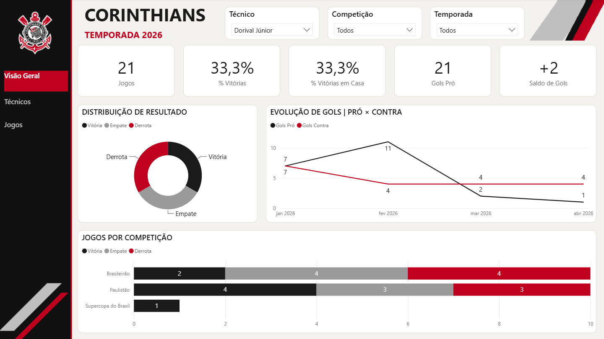
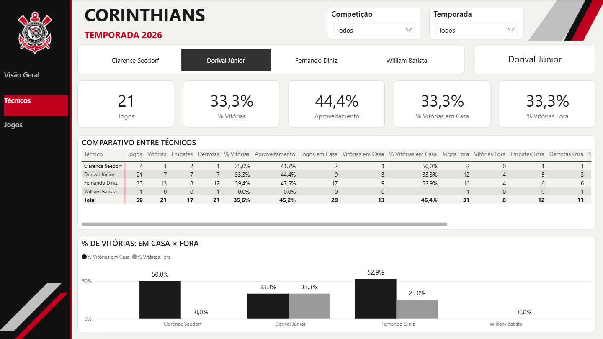
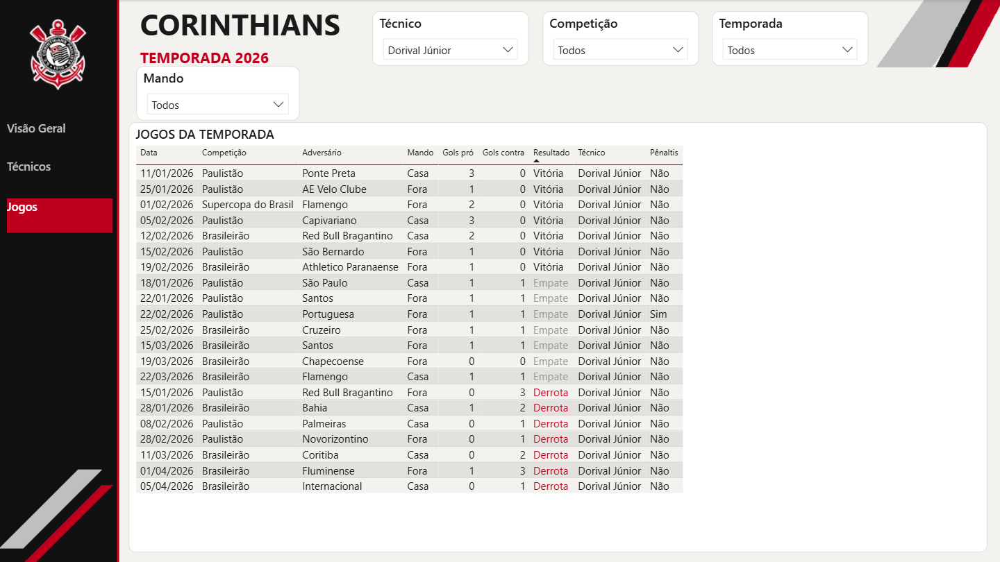

# Dashboard Corinthians - Temporada 2026

Dashboard interativo em Power BI com todos os jogos oficiais do Corinthians em 2026, com filtro por técnico.

Fiz este projeto logo depois que o Clarence Seedorf chegou ao Corinthians, em outubro de 2026. A ideia é comparar os
resultados dele com os dos técnicos que comandaram o time antes na temporada (Dorival Júnior, Fernando Diniz e o
interino William Batista) e acompanhar os números do Seedorf enquanto ele estiver no cargo.

Inspirado no dashboard do São Paulo da [Andressa Xavier](https://github.com/Andressa200702/spfc_powerbi_dashboard).

## Visão Geral



## Técnicos



## Jogos



## Indicadores

- Jogos, % de vitórias e aproveitamento
- % de vitórias em casa e fora
- Gols pró, gols contra e saldo de gols
- Evolução dos gols mês a mês
- Distribuição de resultados e resultados por competição
- Comparativo entre os técnicos
- Tabela jogo a jogo, com filtros por técnico, competição, temporada e mando

## Tecnologias

- Power BI
- Power Query
- DAX
- Python (coleta dos jogos na API pública da ESPN)

## Dados

Os jogos vêm da API pública da ESPN. Como a API não informa o técnico, cada jogo recebe o técnico pelo período em
que ele estava no comando (`data/tecnicos.csv`).

- Jogo decidido nos pênaltis conta como empate.
- Vitória vale 3 pontos, empate 1 e derrota 0. Aproveitamento = pontos ÷ (3 × jogos).
- Jogo em campo neutro não conta como casa nem como fora.

## Estrutura do projeto

```
data/      jogos.csv e tecnicos.csv
etl/       coleta e tratamento dos jogos
img/       prints do dashboard
powerbi/   projeto do Power BI (.pbip) e medidas DAX
```

## Autor

Nickolas
